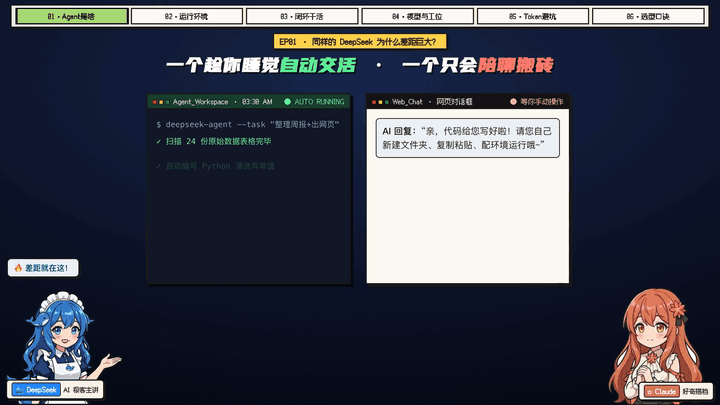

<div align="center">



<br />

[简体中文](README.md) · [繁體中文](README.zh-TW.md) · **English** · [日本語](README.ja.md)

[](LICENSE)
[](#-douyin-video-mcp-reference-10-tools)
[](#-closed-loop-analytics-2s--5s-bounce-rate-diagnostics)
[](https://github.com/honestTai/motion-lib)
[](#-quick-start)
[](https://hrouter.net/)

[Quick Start](#-quick-start) · [Live Gallery](#-live-output--cover-gallery) · [Architecture](#-why-auto-video-workflow-closed-loop-architecture) · [2s/5s Bounce Analytics](#-closed-loop-analytics-2s--5s-bounce-rate-diagnostics) · [Douyin MCP](#-douyin-video-mcp-reference-10-tools) · [Skill Scripts](#-skill-scripts--project-anatomy) · [Private Config](#-local-private-configuration-local)

</div>

---

<!-- HROUTER SPONSOR BANNER -->
<div align="center">
  <a href="https://hrouter.net/" target="_blank" rel="noopener">
    
  </a>
</div>

> ⚡ **Official Compute Partner — [HRouter](https://hrouter.net/)**: **One API Key for Claude, GPT, Gemini & Grok**. Pay-as-you-go with instant balance top-up, transparent per-request billing, and zero wasted monthly subscriptions. Plugs natively into **[Claude Code](https://hrouter.net/docs/claude-code/)**, **[Codex](https://hrouter.net/docs/codex/)**, **[Gemini CLI](https://hrouter.net/docs/gemini-cli/)**, and Image APIs — let your AI coding agent run creator retention diagnostics, write scripts, render 60fps `motion-lib` scenes, generate covers, and publish to Douyin automatically! 👉 **[hrouter.net](https://hrouter.net/)** · **[Models & Pricing](https://hrouter.net/models/)** · **[Quick Setup Docs](https://hrouter.net/docs/index/)**

---

## 🎬 Live Preview

**Give your AI Agent a topic — it researches, scripts, voices, animates, renders at 1080p / 60fps, designs a 3:4 cover, and publishes to Douyin end-to-end.**  
Before writing a single line of copy, the workflow pulls your account's real **2-second / 5-second bounce rates and completion diagnostics** from Douyin Creator Center to sharpen the next video's opening hook, locks word-level TTS timestamps via Volcengine Doubao Speech, authors declarative HTML scenes powered by [motion-lib](https://github.com/honestTai/motion-lib), mixes ducked BGM, renders deterministically via [HyperFrames](https://hyperframes.heygen.com), and publishes through `douyin-video-mcp`.

<div align="center">
  
  <p>
    <sub>▲ Live 1920×1080 60fps frames produced autonomously by the agent (declarative <code>motion-lib</code> scenes + word-aligned pill subtitles + dual 2D corner presenters)</sub>
  </p>
</div>

| Component | Scale / Spec | Role |
|---|---|---|
| **Agent Skill** ([`skills/auto-video-workflow/`](skills/auto-video-workflow/)) | **8-step loop + 8 CLI scripts** | Works across Claude Code, Codex, and Antigravity: analytics review → research → script → voice lock → motion HTML & QA → BGM render → 3:4 cover → publish |
| **Douyin MCP** ([`mcp/`](mcp/) `douyin-video-mcp`) | **10 MCP tools + 1:1 CLI** | Local single-account credential store, **2s/5s bounce & retention analytics**, **per-video peer benchmark & traffic source diagnosis**, search, watermark-free download, and publishing |
| **Visual & Render Spec** | **1920×1080 · 60fps · H.264** | Powered by [`motion-lib`](https://github.com/honestTai/motion-lib) (217 effects + 23 transitions + 6 themes) with `chrome-tall.sh` viewport compensation |
| **Audio & Subtitle Mastering** | **Word-level sync · -16 LUFS** | Bidirectional streaming WebSocket TTS → `timing.js`; `-16 LUFS` voice + `-24 LUFS` sidechain-ducked BGM |

<details open>
<summary><b>✨ Key Highlights (Closed-Loop Bounce Analytics · Voice-First Zero Drift · Local Privacy Isolation)</b></summary>
<br />

- **📊 Pre-Production 2s / 5s Bounce & Retention Diagnostics (Open-Source Built-In)**: Ships with `get_account_analytics` and `get_video_diagnosis` to pull real Creator Center metrics — **views, cover impressions, 2s bounce rate, 5s bounce rate (`bounce_rate_5s`), 5s completion rate, full completion rate, average watch duration, like/comment/collect/share/follow rates**, and **For-You vs. Search traffic shares** — automatically flagging bottlenecks before drafting the next script.
- **🎙️ Voice-First Timeline & Waveform Lip-Sync (Zero Drift)**: `tts.mjs` synthesizes voiceover, measures exact per-scene durations & word timestamps, and extracts a **20fps real audio-energy mouth envelope (`AVW_TIMING.mouth`)** *before* `index.html` is written; `render.mjs` verifies every `<section data-d="...">` against the audio track prior to rendering.
- **👁️ Multimodal Contact-Sheet Self-QA (`snap.mjs`)**: Captures representative frames across every scene into a numbered contact sheet (`snapshots/sheet.jpg`) so the agent visually inspects overflow, contrast, and subtitle safe zones before full 60fps rendering.
- **🔒 Clean Public/Private Separation (`.local/`)**: Account names, keyword pools, persona voice, and custom operational rules live in `.local/` (gitignored) or `~/.config/auto-video-workflow/`, keeping personal strategy 100% out of git history.

</details>

---

## 🎨 Live Output & Cover Gallery

All three explainer episodes below (fact research → dual-voice TTS → `motion-lib` animation → `1080×1440` 3:4 cover → Douyin Creator Center upload) were generated end-to-end by this workflow:

<table>
  <tr>
    <td width="33%" align="center">
      <br />
      <b>EP01 · What Is an AI Agent?</b><br />
      <sub><code>1920×1080</code> · <code>60fps</code> · <code>84.6s</code> · 12 scenes</sub>
    </td>
    <td width="33%" align="center">
      <br />
      <b>EP02 · What Is MCP?</b><br />
      <sub><code>1920×1080</code> · <code>60fps</code> · <code>93.0s</code> · 14 scenes</sub>
    </td>
    <td width="33%" align="center">
      <br />
      <b>EP03 · AI Model Fingerprinting</b><br />
      <sub><code>1920×1080</code> · <code>60fps</code> · <code>99.8s</code> · 15 scenes</sub>
    </td>
  </tr>
</table>

---

## 💡 Why `auto-video-workflow`? (Closed-Loop Architecture)

Most automated video pipelines fail in three places: **publishing blindly without retention feedback**, **animating before TTS (causing audio-subtitle drift)**, and **requiring manual browser clicks on every upload**.

<div align="center">
  
</div>

`auto-video-workflow` unifies the entire lifecycle into an **8-step autonomous loop** that runs nonstop by default (pausing only on missing credentials or explicit `dry-run`):

1. **Creator Analytics Review**: Calls `get_account_analytics` & `get_video_diagnosis` to inspect 2s/5s bounce rates, average watch time, and engagement bottlenecks.
2. **Dual-Channel Fact Research**: Searches top-liked & latest Douyin videos (`search_videos`) + primary web sources with recorded citations.
3. **Copywriting & Packaging**: Writes `script.md` (analytics takeaways + cited script) and `project.json` (scenes, ≤20-char title, tags, 3-part cover copy).
4. **Voice-First Timeline Lock**: `tts.mjs` generates `audio/voice.wav` + word-aligned `timing.js` and writes exact scene durations back to `project.json`.
5. **Declarative Scene Authoring & Visual QA**: Picks the film type (a one-take stage play when the account has recurring characters, a world canvas for data-only videos), acts each line out with a ready-made part (chat window, terminal, code diff, ranking swap, overload…), authors `index.html` with `motion-lib`, then runs `check.mjs` and inspects `snapshots/sheet.jpg` against the aesthetic rules.
6. **Beat Sync, Sound Design, BGM Ducking & 60fps Rendering**: `bgm.mjs pick` measures the music's beat grid so camera moves land on beats, `sfx.mjs` synthesises a sound for every effect, and `bgm.mjs mix` mixes `-16 LUFS` vocals and the effects track over `-24 LUFS` ducked BGM; `render.mjs` outputs `1920×1080` `60fps` MP4 and validates via `ffprobe`.
7. **3:4 Vertical Cover**: Extracts reference frames, generates and crops a `1080×1440` cover (`cover-3x4.png`), and verifies every character on the poster.
8. **Automated Douyin Publishing**: Uploads via `publish_video` (supports public, private, scheduled, or `dry_run=true`) — feeding fresh playback data back into Step 1.

---

## 📊 Closed-Loop Analytics: 2s / 5s Bounce Rate Diagnostics

Checking where viewers swipe away on your recent uploads is the highest-leverage way to improve short-form retention. The open-source `douyin-video-mcp` includes built-in Creator Center analytics tools (see [`references/analytics.md`](skills/auto-video-workflow/references/analytics.md)):

```bash
# 1. Pull playback, 2s/5s bounce rates, completion rates & baseline diagnostics for your last 10 works
mcp/.venv/bin/python mcp/douyin_cli.py analytics --limit 10 --sort latest --min-views 20

# 2. Deep-diagnose a specific video against your historical benchmark + traffic sources
mcp/.venv/bin/python mcp/douyin_cli.py diagnose 7700793742185303332
```

| Funnel Stage | Metric Field | Warning Threshold | Automated Prescription for Next Episode |
|---|---|---|---|
| **First Frame (0–2s)** | `bounce_rate_2s` | `≥ 35%` | Cut intros; show high-contrast headline/visual contrast at `0.0s` in Scene S01 |
| **Golden Hook (0–5s)** | `bounce_rate_5s` (`1 - completion_rate_5s`) | `≥ 62%` | Lead with a counter-intuitive claim or hard number + explicit viewer payoff within 5s |
| **Mid-Roll Retention** | `avg_view_second` / `avg_view_proportion` | `< 12%` | Tighten scenes to 4–6.5s and place a data chart or side-by-side comparison every 15–20s |
| **Saves & Follows** | `favorite_rate` / `subscribe_rate` | `< 0.3%` | Add a screenshot-worthy takeaway checklist card in the penultimate scene |
| **Comments** | `comment_rate` | `< 0.1%` | End with a concrete stance, benchmark cliffhanger, or relatable question echoed in `desc` |

---

## 🚀 Quick Start

### Prerequisites

- **Node.js 18+**, **FFmpeg 4.4+** (`ffmpeg` & `ffprobe`), **Google Chrome**, **Python 3.10+**
- **[motion-lib](https://github.com/honestTai/motion-lib)** (cloned inside or alongside this repo)
- **Volcengine Doubao Speech API Key** (`VOLC_TTS_API_KEY`)

```bash
git clone https://github.com/honestTai/auto-video-workflow.git
cd auto-video-workflow
git clone https://github.com/honestTai/motion-lib

# 1. Install douyin-video-mcp & register with your coding agent
cd mcp
python3 -m venv .venv
.venv/bin/pip install -r requirements.txt
.venv/bin/python -m dy_mcp.install --agent claude        # claude / codex / antigravity / kimi / json

# 2. Bind your Douyin account & capture browser credentials once
.venv/bin/python douyin_cli.py set-account --name "MyAccount" --browser-type chrome   # or webbridge
.venv/bin/python douyin_cli.py refresh
.venv/bin/python douyin_cli.py account                   # runtime_status: saved
cd ..

# 3. Save Volcengine TTS key locally (chmod 600)
mkdir -p ~/.config/auto-video-workflow
printf 'VOLC_TTS_API_KEY=your_key_here\n' > ~/.config/auto-video-workflow/volc.env
chmod 600 ~/.config/auto-video-workflow/volc.env

# 4. Link the Skill to Claude Code / Codex / Antigravity
ln -s "$PWD/skills/auto-video-workflow" ~/.claude/skills/auto-video-workflow
ln -s "$PWD/skills/auto-video-workflow" ~/.codex/skills/auto-video-workflow
```

---

## 🔌 `douyin-video-mcp` Reference (10 Tools)

| MCP Tool | CLI Subcommand | Description |
|---|---|---|
| `account_status` | `account` | Check bound account & credential state (`saved` / `missing`) without exposing secrets |
| `set_account` | `set-account` | Configure account name, `chrome` (CDP) or `webbridge`, and optional proxy |
| `refresh_account_runtime` | `refresh` | Capture cookies, `ticket`, and device fingerprint from logged-in Chrome into local SQLite |
| **`get_account_analytics`** | **`analytics`** | **Fetch recent works' views, 2s/5s bounce rates, completion rates, watch duration & bottleneck diagnostics** |
| **`get_video_diagnosis`** | **`diagnose <id/url>`** | **Compare a single video against historical peer benchmarks + inspect traffic source shares** |
| `search_videos` | `search <keyword>` | Search Douyin videos by relevance, most-liked, or latest with time/duration filters |
| `get_video_info` | `info <id/url>` | Fetch work metadata from URL, numeric ID, or `v.douyin.com` share text |
| `download_video` | `download <id/url>` | Download watermark-free MP4 with multi-CDN fallback |
| `publish_video` | `publish ...` | Upload MP4 + custom 3:4 cover, auto-wrap >20-char titles, deduplicate `#tags`, schedule, or `dry_run` |
| `list_publications` | `publications` | List local publication & dry-run audit records |

---

## 🛠️ Skill Scripts & Project Anatomy

```bash
S=skills/auto-video-workflow/scripts
node $S/init-project.mjs my-video --topic "Topic"
node $S/tts.mjs videos/my-video
node $S/check.mjs videos/my-video     # machine lint: unknown effect names, text under 32px, empty frames on camera arrival…
node $S/snap.mjs videos/my-video
node $S/bgm.mjs list && node $S/bgm.mjs pick videos/my-video --track "keyword"   # choose the music and measure its beats (beats.js)
node $S/sfx.mjs videos/my-video       # effects track: every effect gets a synthesised sound at the moment it fires
node $S/bgm.mjs mix videos/my-video
node $S/render.mjs videos/my-video --grain 2   # optional film grain (none for pixel art)
```

## 🔒 Local Private Configuration (`.local/`)

Copy `.local.example/` to `.local/` (gitignored) or `~/.config/auto-video-workflow/` to keep your account name, keyword pool, `review_analytics` toggle, and personal `strategy.md` creative rules strictly private on your machine.

## 📜 License & Acknowledgements

- Original code in this repository (`skills/`, `mcp/dy_mcp/`, `mcp/tests/`, `mcp/utils/data_util.py`, `mcp/mcp_server.py`, `mcp/douyin_cli.py`, and docs) is released under the **[MIT License](LICENSE)**.
- Douyin signing and base API modules under `mcp/builder/`, `mcp/dy_apis/`, and `mcp/utils/` (excluding `data_util.py`) are derived from [cv-cat/DouYin_Spider](https://github.com/cv-cat/DouYin_Spider) and remain subject to the upstream project's terms (for learning and technical research); see [LICENSE](LICENSE) for details.
- Motion engine: **[motion-lib](https://github.com/honestTai/motion-lib)** (MIT) · Renderer: **[HyperFrames](https://hyperframes.heygen.com)** · Compute Partner: **[HRouter](https://hrouter.net/)**.
