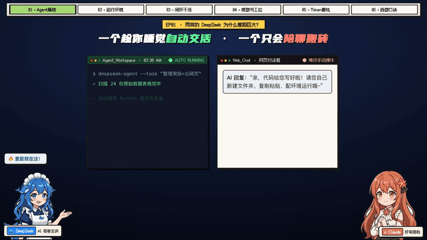

<div align="center">



<br />

[简体中文](README.md) · [繁體中文](README.zh-TW.md) · [English](README.en.md) · **日本語**

[](LICENSE)
[](#-douyin-video-mcp-ツール一覧全-10-種)
[](#-データ分析ループ2-秒--5-秒離脱率と維持率診断)
[](https://github.com/honestTai/motion-lib)
[](#-クイックスタート)
[](https://hrouter.net/)

[クイックスタート](#-クイックスタート) · [出力ギャラリー](#-実機出力--カバーギャラリー) · [アーキテクチャ](#-アーキテクチャデータ駆動の自律ループ) · [2s/5s 離脱率診断](#-データ分析ループ2-秒--5-秒離脱率と維持率診断) · [Douyin MCP](#-douyin-video-mcp-ツール一覧全-10-種) · [Skill スクリプト](#-skill-スクリプト構成) · [ローカル設定](#-ローカル非公開設定local)

</div>

---

<!-- HROUTER SPONSOR BANNER -->
<div align="center">
  <a href="https://hrouter.net/" target="_blank" rel="noopener">
    
  </a>
</div>

> ⚡ **公式コンピュートパートナー [HRouter](https://hrouter.net/)**：**1 つの API キーで Claude / GPT / Gemini / Grok に直結**。従量課金・即時チャージ反映・リクエスト単位の利用明細に対応し、**[Claude Code](https://hrouter.net/docs/claude-code/)**・**[Codex](https://hrouter.net/docs/codex/)**・**[Gemini CLI](https://hrouter.net/docs/gemini-cli/)**, **[DeepSeek](https://hrouter.net/docs/deepseek/)** から「視聴維持率の分析 → 台本作成 → `motion-lib` 60fps レンダリング → サムネイル生成 → Douyin 自動投稿」まで一気通貫で自動実行できます！ 👉 **[公式サイト hrouter.net](https://hrouter.net/)** · **[モデルと料金](https://hrouter.net/models/)** · **[導入ガイド](https://hrouter.net/docs/index/)**

---

## 🎬 ライブプレビュー

**AI エージェントにテーマを 1 行渡すだけで、1080p / 60fps の解説動画を全自動制作し、Douyin（抖音）へ投稿します。**  
制作前にクリエイターセンターから自身のアカウントの**2 秒 / 5 秒離脱率と視聴維持データ**を取得して冒頭 5 秒のフックを改善し、一次情報のリサーチ、台本執筆、豆包音声（Volcengine TTS）による文字単位のタイムスタンプ同期、[motion-lib](https://github.com/honestTai/motion-lib) による宣言型アニメーション生成、BGM ダッキング、[HyperFrames](https://hyperframes.heygen.com) での決定論的レンダリング、`3:4` カバー生成、`douyin-video-mcp` による自動投稿までノンストップで完結します。

<div align="center">
  
  <p>
    <sub>▲ エージェントが全自動生成した 1920×1080 60fps 映像（宣言型 <code>motion-lib</code> シーン + 文字単位同期字幕 + 2D キャラクター口パク連動）</sub>
  </p>
</div>

| モジュール | 規模 / 仕様 | 役割 |
|---|---|---|
| **Agent Skill**（[`skills/auto-video-workflow/`](skills/auto-video-workflow/)） | **8 ステップ自律ループ + 6 スクリプト** | Claude Code / Codex / Antigravity 対応：離脱率復習 → リサーチ → 台本 → 音声ロック → 画面生成 & 検品 → BGM 合成レンダリング → カバー → 投稿 |
| **Douyin MCP**（[`mcp/`](mcp/) `douyin-video-mcp`） | **10 MCP ツール + CLI** | ローカル単一アカウント認証情報の再利用、**2 秒 / 5 秒離脱率・維持率分析**、**過去動画比較 & 流入経路診断**、検索、透かしなし保存、自動投稿 |
| **映像仕様** | **1920×1080 · 60fps · H.264** | [`motion-lib`](https://github.com/honestTai/motion-lib)（217 エフェクト + 23 トランジション + 6 テーマ）+ `chrome-tall.sh` ビューポート補正 |
| **音声・字幕仕様** | **文字単位タイムスタンプ · -16 LUFS** | 双方向ストリーミング TTS → `timing.js`；`-16 LUFS` 音声 + `-24 LUFS` 自動ダッキング BGM |

---

## 🎨 実機出力 & カバーギャラリー

<table>
  <tr>
    <td width="33%" align="center">
      <br />
      <b>EP01 · AI Agent とは何か？</b><br />
      <sub><code>1920×1080</code> · <code>60fps</code> · <code>84.6s</code> · 12 シーン</sub>
    </td>
    <td width="33%" align="center">
      <br />
      <b>EP02 · MCP とは何か？</b><br />
      <sub><code>1920×1080</code> · <code>60fps</code> · <code>93.0s</code> · 14 シーン</sub>
    </td>
    <td width="33%" align="center">
      <br />
      <b>EP03 · AI モデル指紋の検証</b><br />
      <sub><code>1920×1080</code> · <code>60fps</code> · <code>99.8s</code> · 15 シーン</sub>
    </td>
  </tr>
</table>

---

## 💡 アーキテクチャ（データ駆動の自律ループ）

<div align="center">
  
</div>

---

## 📊 データ分析ループ：2 秒 / 5 秒離脱率と維持率診断

```bash
mcp/.venv/bin/python mcp/douyin_cli.py analytics --limit 10 --sort latest --min-views 20
mcp/.venv/bin/python mcp/douyin_cli.py diagnose 7700793742185303332
```

オープンソースの `douyin-video-mcp` に標準搭載された `get_account_analytics` / `get_video_diagnosis` により、`bounce_rate_2s`（2 秒離脱率）、**`bounce_rate_5s`（5 秒離脱率）**、`completion_rate`（完視聴率）、`avg_view_second`（平均視聴秒数）、おすすめ / 検索流入比率を自動取得し、次回動画の冒頭 5 秒フックやシーンテンポへ直接フィードバックします（詳細は [`references/analytics.md`](skills/auto-video-workflow/references/analytics.md)）。

---

## 🚀 クイックスタート

```bash
git clone https://github.com/honestTai/auto-video-workflow.git
cd auto-video-workflow
git clone https://github.com/honestTai/motion-lib

cd mcp
python3 -m venv .venv
.venv/bin/pip install -r requirements.txt
.venv/bin/python -m dy_mcp.install --agent claude        # claude / codex / antigravity / kimi / json

.venv/bin/python douyin_cli.py set-account --name "MyAccount" --browser-type chrome
.venv/bin/python douyin_cli.py refresh
.venv/bin/python douyin_cli.py account
cd ..

mkdir -p ~/.config/auto-video-workflow
printf 'VOLC_TTS_API_KEY=your_key_here\n' > ~/.config/auto-video-workflow/volc.env
chmod 600 ~/.config/auto-video-workflow/volc.env

ln -s "$PWD/skills/auto-video-workflow" ~/.claude/skills/auto-video-workflow
```

---

## 🔌 `douyin-video-mcp` ツール一覧（全 10 種）

| MCP ツール | CLI サブコマンド | 概要 |
|---|---|---|
| `account_status` | `account` | バインド済みアカウントと認証状態を確認（秘密情報は非表示） |
| `set_account` | `set-account` | アカウント名・接続方式（`chrome` / `webbridge`）・プロキシを設定 |
| `refresh_account_runtime` | `refresh` | ログイン済み Chrome から認証情報を取得しローカル SQLite に保存 |
| **`get_account_analytics`** | **`analytics`** | **直近動画の再生数・2 秒/5 秒離脱率・完視聴率・平均視聴時間と改善診断を取得** |
| **`get_video_diagnosis`** | **`diagnose <id/url>`** | **単一動画の過去ベンチマーク比較 + おすすめ/検索などの流入元比率を取得** |
| `search_videos` | `search <keyword>` | キーワード・並び順・期間・尺で Douyin 動画を検索 |
| `get_video_info` | `info <id/url>` | URL・数値 ID・短縮リンクから動画詳細を取得 |
| `download_video` | `download <id/url>` | 透かしなし MP4 をローカルにダウンロード |
| `publish_video` | `publish ...` | MP4 + 3:4 カバー投稿（長文タイトル自動折返し・予約投稿・`dry_run` 対応） |
| `list_publications` | `publications` | ローカル投稿履歴を取得 |

---

## 🛠️ Skill スクリプト構成

```bash
S=skills/auto-video-workflow/scripts
node $S/init-project.mjs my-video --topic "テーマ"
node $S/tts.mjs videos/my-video
node $S/check.mjs videos/my-video     # 機械チェック：エフェクト名の誤り、32px 未満の文字、カメラ到着時の空画面など
node $S/snap.mjs videos/my-video
node $S/bgm.mjs list && node $S/bgm.mjs pick videos/my-video --track "keyword"   # 曲を選び、拍を測る（beats.js。カメラの動きが拍に合う）
node $S/sfx.mjs videos/my-video       # 効果音トラック：各エフェクトの発火時刻に合成した効果音を自動で付ける
node $S/bgm.mjs mix videos/my-video
node $S/render.mjs videos/my-video --grain 2   # フィルムグレイン（ピクセル画では付けない）
node $S/deliver.mjs videos/my-video   # カバー完成後：../ve/my-video/ に 1-video.mp4・2-cover.png・3-copy.md（タイトル・説明・タグ・台本・出典）を納品し、ve/index.md を更新
```

## 🔒 ローカル非公開設定（`.local/`）

`.local.example/` を `.local/`（`.gitignore` 対象）または `~/.config/auto-video-workflow/` にコピーすることで、アカウント名・キーワードプール・個人の運用ルール（`strategy.md`）をリポジトリに含めず安全に管理できます。

## 📜 ライセンスと謝辞

- 本プロジェクト独自のコードは **[MIT License](LICENSE)** の下で公開されています。
- `mcp/builder/`・`mcp/dy_apis/`・`mcp/utils/`（`data_util.py` を除く）の署名および基本 API 実装は [cv-cat/DouYin_Spider](https://github.com/cv-cat/DouYin_Spider) に由来し、上流プロジェクトの規約（学習・技術研究目的）に従います。詳細は [LICENSE](LICENSE) をご確認ください。
- モーションエンジン：**[motion-lib](https://github.com/honestTai/motion-lib)**（MIT）· レンダラー：**[HyperFrames](https://hyperframes.heygen.com)** · コンピュートパートナー：**[HRouter](https://hrouter.net/)**。
