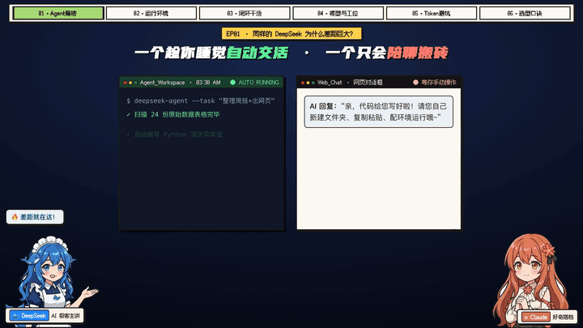

<div align="center">



<br />

**简体中文** · [繁體中文](README.zh-TW.md) · [English](README.en.md) · [日本語](README.ja.md)

[](LICENSE)
[](#-douyin-video-mcp-工具详解10-个)
[](#-数据闭环2s--5s-跳出率与留存短板复盘)
[](https://github.com/honestTai/motion-lib)
[](#-快速开始)
[](https://hrouter.net/)

[快速开始](#-快速开始) · [实机案例画廊](#-实机成片与封面画廊) · [闭环架构](#-为什么要用它闭环架构原理) · [2s/5s 跳出复盘](#-数据闭环2s--5s-跳出率与留存短板复盘) · [抖音 MCP](#-douyin-video-mcp-工具详解10-个) · [Skill 脚本](#-skill-工程脚本与目录解剖) · [私有配置](#-本机私有配置local)

</div>

---

<!-- HROUTER SPONSOR BANNER -->
<div align="center">
  <a href="https://hrouter.net/" target="_blank" rel="noopener">
    
  </a>
</div>

> ⚡ **官方算力合作伙伴 [HRouter](https://hrouter.net/)**：**一把 API Key 直连 Claude / GPT / Gemini / Grok**。无需分别订阅昂贵月费，余额实时到账、消费逐笔可查、用多少付多少。原生兼容 **[Claude Code](https://hrouter.net/docs/claude-code/)**、**[Codex](https://hrouter.net/docs/codex/)**、**[Gemini CLI](https://hrouter.net/docs/gemini-cli/)** 与生图 API —— 让 AI Coding Agent 一口气跑完「拉取账号留存数据 → 搜证写稿 → `motion-lib` 60fps 动效渲染 → 生图出封面 → 自动发抖音」全流程！👉 **[官网 hrouter.net](https://hrouter.net/)** · **[模型与实时价格](https://hrouter.net/models/)** · **[四步接入教程](https://hrouter.net/docs/index/)**

---

## 🎬 实机效果预览

**给 AI Agent 一句话主题，它自己做完一条 1080p / 60fps 的口播讲解视频并发到抖音。**  
从创作者中心**拉取本号近期 2 秒 / 5 秒跳出率与完播诊断**，到抖音与全网一手资料搜证、口播分镜撰写、火山引擎豆包语音逐字对齐配音、[motion-lib](https://github.com/honestTai/motion-lib) 声明式画面编码、BGM 自动闪避混音、[HyperFrames](https://hyperframes.heygen.com) 逐帧确定性渲染、`3:4` 竖版封面生成，直至调用 `douyin-video-mcp` 自动发布上线。

<div align="center">
  
  <p>
    <sub>▲ 由 Agent 全自动生成的 1920×1080 60fps 成片片段（声明式 <code>motion-lib</code> 分镜 + 逐字对齐胶囊字幕 + 双 2D 角落角色口型联动）</sub>
  </p>
</div>

| 模块 | 数量 / 规格 | 核心职责 |
|---|---|---|
| **Agent Skill**（[`skills/auto-video-workflow/`](skills/auto-video-workflow/)） | **8 步闭环 + 8 个 CLI 脚本** | Claude Code / Codex / Antigravity 通用；复盘数据 → 搜证 → 写稿 → 配音锁轴 → 写画面自检 → 混音渲染 → 出封面 → 发布 |
| **抖音 MCP**（[`mcp/`](mcp/) `douyin-video-mcp`） | **10 个 MCP 工具 + 同构 CLI** | 本机单账号凭证复用、**近期作品播放与 2s/5s 跳出率复盘**、**单作同级对比与流量来源诊断**、热榜搜索、无水印下载、自动发布 |
| **画面与渲染规格** | **1920×1080 · 60fps · H.264** | 基于 [`motion-lib`](https://github.com/honestTai/motion-lib)（194 种动效 + 23 种转场 + 6 套主题皮肤），经 `chrome-tall.sh` 视口补偿零裁切输出 |
| **音频与字幕母带** | **逐字时间戳 · -16 LUFS** | 豆包语音双向流式 WebSocket 逐字对齐 `timing.js`；人声 `-16 LUFS` + BGM `-24 LUFS` 动态压限混音 |

<details open>
<summary><b>✨ 核心特性亮点（数据闭环复盘 · 配音先行零错位 · 本机隐私隔离）</b></summary>
<br />

- **📊 出片前自动拉取本号播放与 5 秒跳出数据（开源内置）**：内置 `get_account_analytics` 与 `get_video_diagnosis`，直接从抖音创作者中心拉取每条作品的**播放量、封面展现、2 秒跳出率、5 秒跳出率（`bounce_rate_5s`）、5 秒完播率、整体完播率、平均播放时长、点赞/评论/收藏/分享/吸粉率**及**推荐页/搜索流量占比**，自动对比历史基准定位短板并反哺下一期开头黄金 5 秒钩子。
- **🎙️ 配音先行，真波形口型 + 物理杜绝音画错位**：先由 `tts.mjs` 合成语音，测出每个分镜真实秒数、逐字字幕时间戳，并从 `voice.wav` 提取 **20fps 真实人声能量口型序列 `AVW_TIMING.mouth`**（逗号停顿严格闭嘴、轻重音自然开合），再写 `index.html` 的 `<section data-d="...">`；`render.mjs` 渲染前逐幕校验时长，差一帧都会直接拦截报错。
- **👁️ 多模态截图总览自检（`snap.mjs`）**：每个分镜自动截取代表帧拼成带编号网格图 `snapshots/sheet.jpg`，Agent 亲眼核查文字溢出、元素遮挡与字幕安全区后再进入全量渲染。
- **🔒 公私彻底分离（`.local/` 零泄漏）**：你的账号名、选题关键词池、专属人设与个人运营铁律全部放在 `.local/`（或 `~/.config/auto-video-workflow/`），天然被 `.gitignore` 排除，开源协作与私有配方互不干扰。

</details>

---

## 🎨 实机成片与封面画廊

以下三期科普视频（文案搜证 → 豆包双音色配音 → `motion-lib` 动效编码 → `1080×1440` 3:4 封面 → 抖音创作者中心发布）全程由本工作流端到端自动产出：

<table>
  <tr>
    <td width="33%" align="center">
      <br />
      <b>EP01 · Agent 到底是啥？</b><br />
      <sub><code>1920×1080</code> · <code>60fps</code> · <code>84.6s</code> · 12 分镜</sub>
    </td>
    <td width="33%" align="center">
      <br />
      <b>EP02 · MCP 到底是啥？</b><br />
      <sub><code>1920×1080</code> · <code>60fps</code> · <code>93.0s</code> · 14 分镜</sub>
    </td>
    <td width="33%" align="center">
      <br />
      <b>EP03 · AI 模型指纹揭秘</b><br />
      <sub><code>1920×1080</code> · <code>60fps</code> · <code>99.8s</code> · 15 分镜</sub>
    </td>
  </tr>
</table>

---

## 💡 为什么要用它（闭环架构原理）

做自动化短视频最容易踩的三个坑是：**盲目自嗨不看留存数据**、**先写动画导致配音对不上口型时间轴**、以及**每次上传都要人工扫码点网页**。

<div align="center">
  
</div>

`auto-video-workflow` 将整条链路收拢为严丝合缝的 **8 步自治闭环**（默认一气呵成不停顿，仅在缺配置、凭证过期或用户指定 `dry-run` 时停下）：

```text
主题 / 关键词池
   │
   ▼
① 复盘本号 ── get_account_analytics + get_video_diagnosis：看 2s/5s 跳出率、完播率、均播时长与互动短板
② 搜集资料 ── 抖音同题材爆款与最新作品（search_videos）+ 全网一手公告/论文/实测出处
③ 写口播稿 ── script.md（含数据复盘改进方案 + 事实出处）+ project.json（分镜台词、标题、标签、封面三要素）
④ 豆包配音 ── tts.mjs：流式合成 audio/voice.wav + 逐字时间戳对齐字幕 timing.js + 锁定各幕真实秒数
⑤ 动效画面 ── 填分镜表 → 按 11 个分镜配方写 index.html（世界画布：换内容 = 镜头走过去）→ check.mjs 机器自检 → snap.mjs 截图复核
⑥ 混音渲染 ── sfx.mjs 给每个动效自动配音效 → bgm.mjs 自动闪避混音 → render.mjs 逐帧渲染 1920×1080 60fps MP4 + ffprobe 质检
⑦ 竖版封面 ── 抽代表帧生成 1080×1440（3:4）醒目海报封面，逐字核验三要素无错字
⑧ 自动发布 ── publish_video 上传创作者中心（支持公开 / 仅自己可见 / 定时 / dry-run）→ 播放数据回流第 ① 步 ↺
```

---

## 📊 数据闭环：2s / 5s 跳出率与留存短板复盘

每次做新视频前先看自己账号的真实播放漏斗，比盲目换选题有效得多。`douyin-video-mcp` 开源内置了创作者中心数据拉取与诊断引擎（详见 [`references/analytics.md`](skills/auto-video-workflow/references/analytics.md)）：

```bash
# 1. 拉取最近 10 条作品的播放、2s/5s 跳出率、完播率与均值短板诊断
mcp/.venv/bin/python mcp/douyin_cli.py analytics --limit 10 --sort latest --min-views 20

# 2. 对单条代表作做同级历史基准对比 + 推荐流/搜索流量来源拆解
mcp/.venv/bin/python mcp/douyin_cli.py diagnose 7700793742185303332
```

返回的 `overview` 与 `benchmarks` 会自动计算并标记核心漏斗指标，驱动 Agent 在写下一期剧本时针对性纠偏：

| 漏斗阶段 | 关键指标字段 | 异常诊断阈值 | Agent 自动执行的下期创作处方 |
|---|---|---|---|
| **首帧定生死（0–2s）** | `bounce_rate_2s`（2秒跳出率） | `≥ 35%` | 砍掉一切寒暄铺垫，S01 `0.0s` 直接上高对比大字结论或具象反差图 |
| **黄金钩子（0–5s）** | `bounce_rate_5s`（5秒跳出率 = `1 - completion_rate_5s`） | `≥ 62%` | 前两幕（≤ 5s）直戳痛点或抛硬数字，并亮出「看完能拿走什么」的明确承诺 |
| **中段留存** | `avg_view_second` / `avg_view_proportion` / `completion_rate` | 进度 `< 12%` | 单分镜收紧至 4–6.5 秒快速切镜，每 15–20 秒埋一个数字图表或左右对比锚点 |
| **收藏与转粉** | `favorite_rate` / `subscribe_rate` | 收藏 `< 0.3%` | 倒数第二幕加入可截图照抄的「三条铁律 / 速查对照卡」，强化固定系列栏目感 |
| **评论区裂变** | `comment_rate` | `< 0.1%` | 收尾埋设真实观点碰撞、实测悬念或具体经历提问，并在简介末尾呼应 |

---

## 📂 仓库目录结构

```text
auto-video-workflow/
├── README.md / README.zh-TW.md / README.en.md / README.ja.md
├── LICENSE                       MIT 许可证（附上游签名模块致谢说明）
├── docs/                         SVG 动态横幅、架构图、实机渲染预览 GIF 与封面示例
├── .local.example/               本机私有配置模板（复制为 .local/ 使用，.local/ 已被 gitignore 忽略）
│   ├── profile.example.json      账号名、关键词池、可见性、音色、是否开启出片前数据复盘
│   └── strategy.example.md       个人专属创作规则模板（人设口吻、复盘重点、互动钩子、禁区）
├── mcp/                          douyin-video-mcp（单账号抖音 MCP 服务 + 同构 CLI）
│   ├── mcp_server.py             MCP stdio 启动入口
│   ├── douyin_cli.py             命令行入口（输出标准 JSON，与 MCP 工具一一对应）
│   ├── requirements.txt          Python 依赖
│   ├── .env.example              可选环境变量模板
│   ├── dy_mcp/                   业务核心：server / service / store / session / browser_runtime / cli / install
│   ├── builder/ dy_apis/ utils/  创作者中心数据、搜索、下载、发布接口与请求签名
│   └── tests/                    完整 Pytest 单元测试套件（31 项用例）
└── skills/auto-video-workflow/   通用 Agent Skill（Claude Code / Codex / Antigravity）
    ├── SKILL.md                  8 步全自动工作流主指令
    ├── scripts/
    │   ├── init-project.mjs      初始化单条视频工程并同步 motion-lib 运行时至 lib/
    │   ├── tts.mjs               分镜配音合成、逐字字幕对齐、回写分镜时长与 timing.js
    │   ├── volc-tts.mjs          火山引擎豆包语音双向流式 WebSocket 客户端（含逐字时间戳）
    │   ├── bgm.mjs               本机 BGM 曲库管理、BPM 估算与自动压限闪避混音
    │   ├── sfx.mjs               音效轨：按每个动效的触发时间自动配音效（代码合成，音色跟皮肤走）→ audio/sfx.wav
    │   ├── check.mjs             机器自检：动效名写错、字小于 32px、镜头到位时空屏、文字出画、真素材太少……有 ✗ 必须改
    │   ├── shot.mjs              给出处网页截图存进 assets/shots/，当片子里的真素材
    │   ├── snap.mjs              每个分镜截「到位帧 + 后段帧」拼成 sheet.jpg，另出手机尺寸的 phone.jpg
    │   ├── render.mjs            时长一致性核验 + 1080p 60fps 渲染 + 音轨合成 + ffprobe 质检
    │   └── lib.mjs               配置加载、字幕断句对齐与 Chrome 视口包装器工具库
    └── references/
        ├── analytics.md          账号播放数据拉取、2s/5s 跳出率解读与创作纠偏处方
        ├── copywriting.md        口播三段式结构、黄金 5 秒钩子公式、标题/简介/封面三要素规范
        ├── motion-lib-guide.md   motion-lib 五套皮肤选型、语法速查、音画对齐与安全区规范
        └── setup.md              首次环境与凭证配置指南
```

---

## 🚀 快速开始

### 环境要求

| 工具 | 版本 | 用途 |
|---|---|---|
| **Node.js** | 18+ | 运行 Skill 脚本与 `npx hyperframes` |
| **FFmpeg（含 ffprobe）** | 4.4+ | 音频响度归一化、闪避混音、音画合成与成片质检 |
| **Google Chrome** | 近期版本 | HyperFrames 无头渲染 + 采集抖音网页登录凭证 |
| **Python** | 3.10+ | 运行 `douyin-video-mcp` |
| **[motion-lib](https://github.com/honestTai/motion-lib)** | 最新版 | HTML → 60fps 视频声明式动效库 |
| **豆包语音 API Key** | — | 火山引擎「豆包语音合成大模型」（支持逐字时间戳） |

### 1. 克隆本仓库与 `motion-lib`

```bash
git clone https://github.com/honestTai/auto-video-workflow.git
cd auto-video-workflow
git clone https://github.com/honestTai/motion-lib      # 放在仓库内或同级目录均可被自动识别
```

### 2. 安装并注册 `douyin-video-mcp`

```bash
cd mcp
python3 -m venv .venv                                    # 系统 Python < 3.10 可用: uv venv --python 3.12 .venv
.venv/bin/pip install -r requirements.txt
.venv/bin/python -m dy_mcp.install --agent claude        # 支持 claude / codex / antigravity / kimi / json
```

### 3. 绑定抖音账号并采集本机凭证

只保存一个账号。凭证（Cookie、`ticket`、设备指纹）从你已登录抖音的 Chrome 采集后存入本机 SQLite（`mcp/.data/douyin.db`），**后续拉取数据、搜索与发布直接复用，无需保持浏览器常驻开启**（两种连接方式详见 [`setup.md`](skills/auto-video-workflow/references/setup.md)）：

```bash
.venv/bin/python douyin_cli.py set-account --name "我的账号" --browser-type chrome   # 或 webbridge
.venv/bin/python douyin_cli.py refresh
.venv/bin/python douyin_cli.py account                   # runtime_status 显示 saved 即就绪
.venv/bin/python douyin_cli.py analytics --limit 5       # 测试拉取本号近期播放与 5 秒跳出数据
cd ..
```

### 4. 配置豆包语音 API Key

在本机配置文件写入密钥（权限 `600`，切勿把密钥直接发进聊天窗口）：

```bash
mkdir -p ~/.config/auto-video-workflow
printf 'VOLC_TTS_API_KEY=你的火山引擎豆包语音Key\n' > ~/.config/auto-video-workflow/volc.env
chmod 600 ~/.config/auto-video-workflow/volc.env
```

### 5. 挂载 Skill 并一句话启动出片

```bash
# 软链到你常用的 AI Coding Agent
ln -s "$PWD/skills/auto-video-workflow" ~/.claude/skills/auto-video-workflow     # Claude Code
ln -s "$PWD/skills/auto-video-workflow" ~/.codex/skills/auto-video-workflow      # Codex
mkdir -p ~/.gemini/config/skills && ln -s "$PWD/skills/auto-video-workflow" ~/.gemini/config/skills/auto-video-workflow  # Antigravity
```

在仓库目录下向 Agent 直接下达指令（推荐搭配 **[HRouter](https://hrouter.net/)** 接入 Claude / GPT / Gemini）：

```text
做一期关于「MCP 装太多 AI 反而变慢」的视频发抖音
```

> 💡 **首次试跑建议**：在 `.local/profile.json` 中设置 `"visibility": 1`（仅自己可见），或在对话里加上「`dry-run`」，确认成片质感与排版符合预期后再改为公开发布（`"visibility": 0`）。

---

## 🔌 `douyin-video-mcp` 工具详解（10 个）

MCP 工具与 `douyin_cli.py` 子命令严格一一对应，既可挂载给 Agent 自动调用，也可在终端或你自己的脚本里独立使用：

| MCP 工具名 | 对应 CLI 子命令 | 功能说明 |
|---|---|---|
| `account_status` | `account` | 查看当前绑定账号与凭证状态（`saved` / `missing`），绝不泄露敏感凭证原文 |
| `set_account` | `set-account` | 绑定或切换采集方式（`chrome` 远程调试端口 / `webbridge` 浏览器扩展桥）及可选代理 |
| `refresh_account_runtime` | `refresh` | 从已登录抖音的 Chrome 一键采集并刷新本地持久化登录态 |
| **`get_account_analytics`** | **`analytics`** | **拉取近期作品播放量、2s/5s 跳出率、完播率、均播时长、互动吸粉率及自动短板诊断** |
| **`get_video_diagnosis`** | **`diagnose <ID/链接>`** | **单条作品深度诊断：相对本号历史同类作品的各项指标优劣对比 + 推荐/搜索流量来源占比** |
| `search_videos` | `search <关键词>` | 按关键词搜索抖音视频（支持综合 / 最多点赞 / 最新发布排序，及时间与时长过滤） |
| `get_video_info` | `info <ID/链接>` | 查看任意作品详情；支持视频链接、纯数字 ID 或含 `v.douyin.com` 短链的分享口令 |
| `download_video` | `download <ID/链接>` | 下载无水印高清原片到本地（自动回退多清晰度 CDN 节点） |
| `publish_video` | `publish ...` | 发布本地视频至创作者中心（支持自定义封面、话题去重、>20 字长标题自动折入简介、定时与 `dry_run`） |
| `list_publications` | `publications` | 查询本机历史发布与校验流水记录 |

<details>
<summary><b>查看常用 <code>douyin_cli.py</code> 命令行调用示例</b></summary>
<br />

```bash
cd mcp

# 1. 复盘本号最近 10 条作品播放与 5 秒跳出率，以及单条代表作同级对比
.venv/bin/python douyin_cli.py analytics --limit 10 --sort latest --min-views 20
.venv/bin/python douyin_cli.py diagnose "https://www.douyin.com/video/7700793742185303332"

# 2. 搜索同题材爆款与下载对标样片
.venv/bin/python douyin_cli.py search "Claude Code" --sort 1 --publish-time 7 --limit 10
.venv/bin/python douyin_cli.py info "https://www.douyin.com/video/7703394811079920911"
.venv/bin/python douyin_cli.py download "https://www.douyin.com/video/7703394811079920911"

# 3. 校验或正式发布视频
.venv/bin/python douyin_cli.py publish \
  --video ../videos/my-ep/renders/my-ep.mp4 \
  --cover ../videos/my-ep/cover/cover-3x4.png \
  --title "别再给你的 AI 瞎装 MCP 了" \
  --desc "装得越多，AI 反而越慢。" \
  --tags "AI,MCP,AI工具" \
  --dry-run
```

</details>

---

## 🛠️ Skill 工程脚本与目录解剖

除让 Agent 全自动执行外，你也可以随时手动分步运行 `skills/auto-video-workflow/scripts/` 下的脚本：

```bash
S=skills/auto-video-workflow/scripts

node $S/init-project.mjs my-video --topic "主题"          # 1. 创建 videos/my-video/ 并同步 motion-lib 到 lib/
node $S/tts.mjs videos/my-video                           # 2. 豆包配音 + 逐字字幕对齐 + 生成 timing.js
node $S/check.mjs videos/my-video                         # 3. 机器自检，有 ✗ 就改，直到通过
node $S/snap.mjs videos/my-video                          #    再截图：snapshots/sheet.jpg（到位帧 + 后段帧）和 phone.jpg（手机尺寸）
node $S/sfx.mjs videos/my-video                           # 4. 音效轨：每个动效自动配一个音效
node $S/bgm.mjs list && node $S/bgm.mjs mix videos/my-video --track "曲名"  #    配音 + 音效 + BGM 自动压限闪避混音
node $S/render.mjs videos/my-video                        # 5. 校验分镜时长 + 渲染 1080p 60fps 成片 + ffprobe 质检
```

每条视频都是 `videos/<slug>/` 下一个完全自包含的独立工程：

```text
videos/<slug>/
├── project.json      分镜台词、双人音色、主题皮肤、发布文案与封面三要素；tts.mjs 会回写精确起止秒数
├── script.md         账号数据复盘结论、一手资料出处链接、口播定稿全文
├── index.html        motion-lib 声明式分镜源码（可在浏览器打开 index.html?play 实时按空格预览）
├── timing.js         tts.mjs 自动生成：逐字对齐字幕数组 AVW_TIMING.subtitles 与各分镜精确时长
├── lib/              motion-lib 运行时副本（fx.js / fx.css / 字体 / vendor / chrome-tall.sh）
├── audio/            voice.wav（纯净配音）、mix.wav（-16 LUFS 人声 + -24 LUFS 自动闪避 BGM）
├── snapshots/        各分镜高清抽帧与网格总览检视表 sheet.jpg
├── renders/          最终导出的 1920×1080 60fps MP4 成片
└── cover/            参考抽帧与裁剪对齐后的 1080×1440（3:4）发布封面
```

---

## 🔒 本机私有配置（`.local/`）

你的个人账号名、选题池和独家运营心法不应提交进公开代码库。将 `.local.example/` 复制为 `.local/`（或放入 `~/.config/auto-video-workflow/`），工作流启动时会自动优先加载：

```bash
cp -R .local.example .local
```

| 文件 | 作用说明 |
|---|---|
| `.local/profile.json` | 配置 `account`（绑定账号名）、`keywords`（自动选题池）、`visibility`（默认可见性）、`review_analytics`（默认 `true`，每次出片前自动拉取本号播放数据）、`analytics_limit`、`voices`、`motion_lib` |
| `.local/strategy.md` | **个人专属创作与复盘流程**（优先级高于通用 `SKILL.md`）：可写入「每次出片前必查 5 秒跳出率并写三条改进动作」「片尾必埋评论区互动钩子」「固定角色搭档与口吻禁区」等私有规则 |

---

## 🧪 运行测试

```bash
cd mcp
.venv/bin/pip install pytest
.venv/bin/python -m pytest tests -v
```

---

## ❓ 常见问题

<details>
<summary><b>新发布的视频拉取 <code>analytics</code> 时跳出率显示为 <code>null</code>？</b></summary>
刚发布且播放量为 <code>0</code> 的作品尚无留存统计，<code>normalize_creator_metrics</code> 会将跳出率记为 <code>null</code>，并通过 <code>min_views=20</code> 自动将其排除在账号近期均值基准线之外，避免污染历史均值。
</details>

<details>
<summary><b>为什么必须先跑 <code>tts.mjs</code> 再写 <code>index.html</code>？</b></summary>
因为口播每句话的真实朗读时长取决于语速、停顿与数字读法，靠估算秒数写动画必然导致音画错位。<code>tts.mjs</code> 会先测出每一幕精确到毫秒的时长并生成 <code>timing.js</code>，<code>render.mjs</code> 渲染前会强制核对 <code>data-d</code>，不一致直接报错拦截。
</details>

<details>
<summary><b>浏览器需要一直开着才能拉数据或发视频吗？</b></summary>
不需要。只有首次执行 <code>douyin_cli.py refresh</code>（或登录态过期重刷）时需要读取已登录抖音的 Chrome；采集完成后凭证保存在本机 <code>mcp/.data/douyin.db</code>，日常拉取播放数据、搜索与发布均独立运行。
</details>

<details>
<summary><b>渲染出的成片底部字幕被裁掉了一截？</b></summary>
桌面版 Chrome 无头模式默认视口比窗口高度矮约 90px。使用 <code>render.mjs</code> 与 <code>snap.mjs</code> 会自动挂载工程内的 <code>lib/chrome-tall.sh</code> 补偿视口高度；若手动执行 <code>npx hyperframes render</code>，请务必带上 <code>HYPERFRAMES_BROWSER_PATH="$PWD/lib/chrome-tall.sh"</code>。
</details>

---

## ⚠️ 安全与合规须知

- **妥善保管本机凭证**：`mcp/.data/douyin.db` 与 `~/.config/auto-video-workflow/volc.env` 含有明文登录态与 API 密钥，仅限本机存放，切勿提交到 Git 仓库或发送给他人。
- **合理控制调用频率**：仅限用于你本人合法持有的抖音账号。搜索、数据拉取与发布基于网页端接口，请勿高频并发调用；若触发平台验证码或二次验证，请在浏览器内手动完成后重新执行 `refresh`。
- **内容与版权责任**：事实数据请确保有据可查（工作流要求逐条记录出处），BGM 与画面素材请确保拥有合法使用权，遵守平台社区规范与所在地法律法规。

---

## 📜 开源许可与致谢

- **本项目原创代码**（`skills/`、`mcp/dy_mcp/`、`mcp/tests/`、`mcp/utils/data_util.py`、`mcp/mcp_server.py`、`mcp/douyin_cli.py` 及全部文档与可视化资产）遵循 **[MIT License](LICENSE)** 开源。
- **上游致谢**：`mcp/builder/`、`mcp/dy_apis/`、`mcp/utils/`（除 `data_util.py` 外）中的抖音网页签名与基础接口实现源自 [cv-cat/DouYin_Spider](https://github.com/cv-cat/DouYin_Spider) 并针对单账号搜索、下载、发布与创作者数据复盘做了精简与扩展，特此致谢；该部分派生文件遵循上游仓库条款（仅供学习与技术研究），详见 [LICENSE](LICENSE) 末尾说明。
- **渲染生态**：声明式动效引擎由 **[motion-lib](https://github.com/honestTai/motion-lib)**（MIT）驱动，逐帧确定性渲染基于 **[HyperFrames](https://hyperframes.heygen.com)**。
- **算力伙伴**：感谢 **[HRouter (hrouter.net)](https://hrouter.net/)** 提供一站式多模型 AI Coding Agent 与生图算力路由支持。
