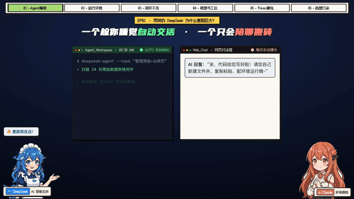

<div align="center">



<br />

[简体中文](README.md) · **繁體中文** · [English](README.en.md) · [日本語](README.ja.md)

[](LICENSE)
[](#-douyin-video-mcp-工具詳解10-個)
[](#-數據閉環2s--5s-跳出率與留存短板復盤)
[](https://github.com/honestTai/motion-lib)
[](#-快速開始)
[](https://hrouter.net/)

[快速開始](#-快速開始) · [實機案例畫廊](#-實機成片與封面畫廊) · [閉環架構](#-為什麼要用它閉環架構原理) · [2s/5s 跳出復盤](#-數據閉環2s--5s-跳出率與留存短板復盤) · [抖音 MCP](#-douyin-video-mcp-工具詳解10-個) · [Skill 腳本](#-skill-工程腳本與目錄解剖) · [私有配置](#-本機私有配置local)

</div>

---

<!-- HROUTER SPONSOR BANNER -->
<div align="center">
  <a href="https://hrouter.net/" target="_blank" rel="noopener">
    
  </a>
</div>

> ⚡ **官方算力合作夥伴 [HRouter](https://hrouter.net/)**：**一把 API Key 直連 Claude / GPT / Gemini / Grok**。無需分別訂閱昂貴月費，餘額即時到帳、消費逐筆可查、用多少付多少。原生相容 **[Claude Code](https://hrouter.net/docs/claude-code/)**、**[Codex](https://hrouter.net/docs/codex/)**、**[Gemini CLI](https://hrouter.net/docs/gemini-cli/)**, **[DeepSeek](https://hrouter.net/docs/deepseek/)** 與生圖 API —— 讓 AI Coding Agent 一口氣跑完「拉取帳號留存數據 → 搜證寫稿 → `motion-lib` 60fps 動效渲染 → 生圖出封面 → 自動發抖音」全流程！👉 **[官網 hrouter.net](https://hrouter.net/)** · **[模型與即時價格](https://hrouter.net/models/)** · **[快速接入教學](https://hrouter.net/docs/index/)**

---

## 🎬 實機效果預覽

**給 AI Agent 一句話主題，它自己做完一條 1080p / 60fps 的口播講解影片並發到抖音。**  
從創作者中心**拉取本號近期 2 秒 / 5 秒跳出率與完播診斷**，到抖音與全網一手資料搜證、口播分鏡撰寫、豆包語音逐字對齊配音、[motion-lib](https://github.com/honestTai/motion-lib) 宣告式畫面編碼、BGM 自動閃避混音、[HyperFrames](https://hyperframes.heygen.com) 逐格決定性渲染、`3:4` 直式封面生成，直至呼叫 `douyin-video-mcp` 自動發布上線。

<div align="center">
  
  <p>
    <sub>▲ 由 Agent 全自動產出的 1920×1080 60fps 成片片段（宣告式 <code>motion-lib</code> 分鏡 + 逐字對齊膠囊字幕 + 雙 2D 角落角色口型聯動）</sub>
  </p>
</div>

| 模組 | 數量 / 規格 | 核心職責 |
|---|---|---|
| **Agent Skill**（[`skills/auto-video-workflow/`](skills/auto-video-workflow/)） | **8 步閉環 + 6 個 CLI 腳本** | Claude Code / Codex / Antigravity 通用；復盤數據 → 搜證 → 寫稿 → 配音鎖軸 → 寫畫面自檢 → 混音渲染 → 出封面 → 發布 |
| **抖音 MCP**（[`mcp/`](mcp/) `douyin-video-mcp`） | **10 個 MCP 工具 + 同構 CLI** | 本機單帳號憑證複用、**近期作品播放與 2s/5s 跳出率復盤**、**單作同級對比與流量來源診斷**、熱榜搜尋、無浮水印下載、自動發布 |
| **畫面與渲染規格** | **1920×1080 · 60fps · H.264** | 基於 [`motion-lib`](https://github.com/honestTai/motion-lib)（217 種動效 + 23 種轉場 + 6 套主題皮膚），經 `chrome-tall.sh` 視口補償零裁切輸出 |
| **音訊與字幕母帶** | **逐字時間戳 · -16 LUFS** | 豆包語音雙向串流 WebSocket 逐字對齊 `timing.js`；人聲 `-16 LUFS` + BGM `-24 LUFS` 動態壓限混音 |

---

## 🎨 實機成片與封面畫廊

<table>
  <tr>
    <td width="33%" align="center">
      <br />
      <b>EP01 · Agent 到底是啥？</b><br />
      <sub><code>1920×1080</code> · <code>60fps</code> · <code>84.6s</code> · 12 分鏡</sub>
    </td>
    <td width="33%" align="center">
      <br />
      <b>EP02 · MCP 到底是啥？</b><br />
      <sub><code>1920×1080</code> · <code>60fps</code> · <code>93.0s</code> · 14 分鏡</sub>
    </td>
    <td width="33%" align="center">
      <br />
      <b>EP03 · AI 模型指紋揭秘</b><br />
      <sub><code>1920×1080</code> · <code>60fps</code> · <code>99.8s</code> · 15 分鏡</sub>
    </td>
  </tr>
</table>

---

## 💡 為什麼要用它（閉環架構原理）

<div align="center">
  
</div>

1. **復盤本號播放數據**：呼叫 `get_account_analytics` 與 `get_video_diagnosis` 檢視 2 秒 / 5 秒跳出率、完播率、均播時長與互動短板。
2. **雙通道事實搜證**：搜尋抖音高讚與最新作品（`search_videos`）+ 全網一手資料並逐條記錄出處。
3. **撰寫分鏡與發布資訊**：產出 `script.md` 與 `project.json`（含 ≤20 字標題、標籤、封面三要素）。
4. **配音先行鎖定時間軸**：`tts.mjs` 合成 `audio/voice.wav` 與逐字對齊 `timing.js`，物理杜絕音畫錯位。
5. **宣告式動效與截圖自檢**：先定片型（有 IP 角色用舞台劇 · 一鏡到底，純資料用世界畫布），逐句挑零件「演」出來，用 `motion-lib` 撰寫 `index.html`，執行 `check.mjs` 與 `snap.mjs`，對照審美準則逐格檢查。
6. **卡點、音效、BGM 閃避混音與 60fps 渲染**：`bgm.mjs pick` 量出拍子讓換場卡點，`sfx.mjs` 給每個動效配音效，`bgm.mjs mix` + `render.mjs` 輸出 `1920×1080` `60fps` MP4 並以 `ffprobe` 驗收。
7. **3:4 直式封面海報與交付**：抽取代表格生成並裁切 `1080×1440` 封面，逐字核驗無錯字；再用 `deliver.mjs` 把成片、封面、文案交付到 `ve/<slug>/`，方便同步雲端硬碟、給同事看。
8. **自動發布回流**：呼叫 `publish_video` 發布至創作者中心，最新播放數據回流至下一步循環。

---

## 📊 數據閉環：2s / 5s 跳出率與留存短板復盤

```bash
mcp/.venv/bin/python mcp/douyin_cli.py analytics --limit 10 --sort latest --min-views 20
mcp/.venv/bin/python mcp/douyin_cli.py diagnose 7700793742185303332
```

詳見 [`references/analytics.md`](skills/auto-video-workflow/references/analytics.md)：自動計算 `bounce_rate_2s`（2秒跳出率）、**`bounce_rate_5s`（5秒跳出率）**、`completion_rate`、`avg_view_second` 與推薦流/搜尋流量佔比，讓 Agent 在寫下一期劇本前精準修正黃金前 5 秒鉤子與中段節奏。

---

## 🚀 快速開始

```bash
git clone https://github.com/honestTai/auto-video-workflow.git
cd auto-video-workflow
git clone https://github.com/honestTai/motion-lib

# 1. 安裝抖音 MCP
cd mcp
python3 -m venv .venv
.venv/bin/pip install -r requirements.txt
.venv/bin/python -m dy_mcp.install --agent claude        # claude / codex / antigravity / kimi / json

# 2. 綁定帳號並擷取本機 Chrome 憑證（僅需一次，後續免開瀏覽器複用）
.venv/bin/python douyin_cli.py set-account --name "我的帳號" --browser-type chrome
.venv/bin/python douyin_cli.py refresh
.venv/bin/python douyin_cli.py account
cd ..

# 3. 設定豆包語音金鑰
mkdir -p ~/.config/auto-video-workflow
printf 'VOLC_TTS_API_KEY=你的Key\n' > ~/.config/auto-video-workflow/volc.env
chmod 600 ~/.config/auto-video-workflow/volc.env

# 4. 連結 Skill
ln -s "$PWD/skills/auto-video-workflow" ~/.claude/skills/auto-video-workflow
```

---

## 🔌 `douyin-video-mcp` 工具詳解（10 個）

| MCP 工具 | CLI 子命令 | 說明 |
|---|---|---|
| `account_status` | `account` | 查看綁定帳號與憑證狀態（不回傳敏感內容） |
| `set_account` | `set-account` | 設定帳號名稱、連接方式（`chrome` / `webbridge`）與代理 |
| `refresh_account_runtime` | `refresh` | 從已登入抖音的瀏覽器擷取並儲存憑證 |
| **`get_account_analytics`** | **`analytics`** | **拉取近期作品播放、2s/5s 跳出率、完播率、均播時長與短板診斷** |
| **`get_video_diagnosis`** | **`diagnose <ID/連結>`** | **單條作品同級歷史基準對比 + 推薦/搜尋流量來源拆解** |
| `search_videos` | `search <關鍵詞>` | 依關鍵詞搜尋影片（支援綜合 / 最多按讚 / 最新發布） |
| `get_video_info` | `info <ID/連結>` | 查看作品詳情（支援短網址口令、連結或純數字 ID） |
| `download_video` | `download <ID/連結>` | 下載無浮水印高畫質原片 |
| `publish_video` | `publish ...` | 發布本地影片與 3:4 封面（支援 `dry_run`、排程與可見性） |
| `list_publications` | `publications` | 查看本機發布與校驗紀錄 |

---

## 🛠️ Skill 工程腳本與目錄解剖

```bash
S=skills/auto-video-workflow/scripts
node $S/init-project.mjs my-video --topic "主題"
node $S/tts.mjs videos/my-video
node $S/check.mjs videos/my-video     # 機器自檢：動效名寫錯、字小於 32px、鏡頭到位時空屏……有 ✗ 必須改
node $S/snap.mjs videos/my-video
node $S/bgm.mjs list && node $S/bgm.mjs pick videos/my-video --track "曲名"   # 選曲並量出拍子（beats.js），換場自動卡點
node $S/sfx.mjs videos/my-video       # 音效軌：每個動效按觸發時間自動配一個音效
node $S/bgm.mjs mix videos/my-video
node $S/render.mjs videos/my-video --grain 2   # 膠片顆粒（像素風不加）
node $S/deliver.mjs videos/my-video   # 做完封面後交付：../ve/my-video/ 放 1-video.mp4、2-cover.png、3-copy.md（標題簡介話題、口播全文、出處）
```

## 🔒 本機私有配置（`.local/`）

將 `.local.example/` 複製為 `.local/`（已被 `.gitignore` 排除）或放入 `~/.config/auto-video-workflow/`，即可設定私有的 `profile.json` 與個人專屬營運規則 `strategy.md`。

## 📜 開源授權與致謝

- 本專案原創程式碼遵循 **[MIT License](LICENSE)** 開源。
- `mcp/builder/`、`mcp/dy_apis/`、`mcp/utils/`（除 `data_util.py` 外）衍生自 [cv-cat/DouYin_Spider](https://github.com/cv-cat/DouYin_Spider)，遵循上游條款（僅供學習與技術研究），詳見 [LICENSE](LICENSE)。
- 動效引擎：**[motion-lib](https://github.com/honestTai/motion-lib)**（MIT）· 渲染：**[HyperFrames](https://hyperframes.heygen.com)** · 算力夥伴：**[HRouter](https://hrouter.net/)**。
